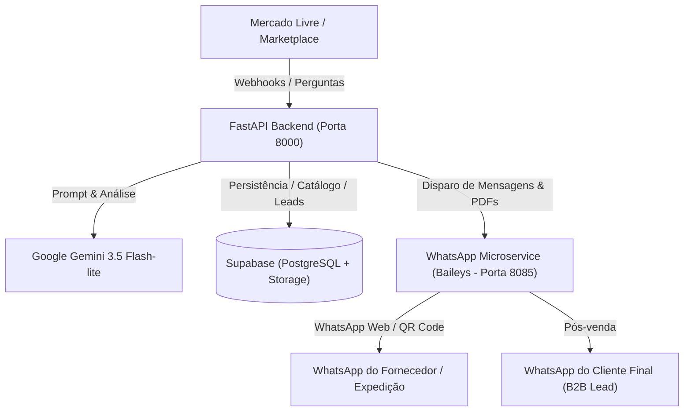

# Viditex Distribuidora — Autonomous B2B Dropshipping & Crossdocking Engine

Plataforma autônoma e completa para operação de e-commerce e marketplace (Mercado Livre) no modelo **crossdocking / dropshipping B2B** de laminados sintéticos (courvin, corino e tecidos automotivos e náuticos).

O sistema opera sem necessidade de estoque próprio, automatizando ponta a ponta:
1. **Geração Inteligente de Anúncios:** Criação automática de anúncios segmentados por nicho (Automotivo, Náutico, Moveleiro) com IA Gemini.
2. **Logística e Filtro de Atacado:** Agente autônomo com triagem inteligente para Mercado Envios vs. Cotação de Transportadora para grandes volumes (>= R$ 5.000).
3. **Despacho Direto ao Fornecedor:** Download de etiquetas do marketplace (PDF) e envio de ordens de corte via WhatsApp diretamente para o galpão de expedição.
4. **Pós-Venda e Conversão B2B:** Identificação autônoma de compradores profissionais (tapeceiros, montadores, fabricantes) 24h após a entrega para venda recorrente direta no atacado.
5. **Microserviço WhatsApp Embutido (100% Gratuito):** Conector local baseado em Baileys com persistência de sessão e interface web com QR Code.

---

## 🏗️ Arquitetura do Sistema



---

## ⚡ Funcionalidades em Detalhes

### 1. 🤖 Agente de Cotações com Filtro de Atacado (`services/freight_quote_agent.py`)
- Intercepta dúvidas sobre frete enviadas pelos compradores no marketplace.
- **Pedidos Fracionados (< R$ 5.000):** A IA responde imediatamente ao cliente que o frete e prazo são calculados pelo Mercado Envios diretamente no simulador do anúncio, **sem incomodar o fornecedor**.
- **Grandes Volumes de Atacado (>= R$ 5.000):** Detecta compra de carga fechada e envia cotação formatada via WhatsApp ao fornecedor. Quando o fornecedor responde o preço, a IA lê e responde o comprador no marketplace.

### 2. ✂️ Despachador de Pedidos com Etiqueta PDF (`services/order_dispatcher.py`)
- Recebe a confirmação de compra do marketplace.
- Baixa a etiqueta de envio oficial (PDF) e a armazena no Supabase Storage.
- Dispara uma mensagem formatada ao WhatsApp do galpão com as medidas exatas de corte sem emenda e o arquivo PDF da etiqueta anexo para colagem imediata no pacote.

### 3. 🎯 Qualificador de Pós-Venda B2B (`services/post_sales_b2b.py`)
- Dispara uma mensagem amigável no WhatsApp do cliente 24h após a entrega do produto.
- Quando o cliente responde, o Gemini analisa a mensagem para identificar se ele é um profissional (tapeceiro, capoteiro, fabricante de móveis, estofador náutico).
- Em caso positivo, o contato é salvo em `sinteticos_leads_b2b` e o robô oferece a tabela de preços de atacado direto de fábrica para compras recorrentes.

### 4. 📱 Microserviço WhatsApp Local (`whatsapp_service/`)
- Não requer planos pagos de terceiros (Evolution API paga, Z-API, Twilio).
- Interface web pronta em `http://localhost:8085/qrcode` com auto-refresh.
- Sessão multi-device salva em disco: reconecta instantaneamente ao reiniciar a máquina sem precisar escanear o QR Code de novo.
- Roteamento inteligente de mensagens recebidas: identifica se a resposta veio do fornecedor ou do cliente e direciona para o webhook correto.

---

## 📂 Estrutura do Repositório

```
.
├── api/                           # Sub-rotas e endpoints auxiliares
├── core/                          # Configurações e clientes essenciais
│   ├── ai.py                      # Conector Google Gemini
│   ├── config.py                  # Pydantic Settings (.env)
│   ├── database.py                # Cliente Supabase
│   └── whatsapp.py                # Wrapper compatível com Evolution API / Baileys
├── data/                          # Schemas SQL e dados base de catálogo
│   ├── full_schema_and_seed.sql   # DDL completo do Supabase e produtos base
│   ├── seed_produtos.sql          # Seed dos sintéticos
│   └── TABELA_CUSTOS_PRODUTOS.md  # Referência de metragens e custos
├── models/                        # Schemas Pydantic para validação
│   └── schemas.py                 # Payloads de webhooks e modelos de dados
├── services/                      # Lógica de negócio autônoma
│   ├── ad_generator_service.py    # Geração de anúncios segmentados
│   ├── freight_quote_agent.py     # Triagem e cotação de frete
│   ├── order_dispatcher.py        # Despacho de corte e etiquetas
│   └── post_sales_b2b.py          # Prospecção e pós-venda
├── whatsapp_service/              # Microserviço Node.js Baileys
│   ├── server.js                  # Servidor Express compatível com Evolution API
│   └── package.json               # Dependências Node.js
├── scripts/                       # Utilitários de setup e testes
├── .env.example                   # Modelo limpo de variáveis de ambiente
├── Dockerfile                     # Imagem Docker para deploy em nuvem
├── iniciar_tudo.bat               # Launcher Windows 1-clique (WhatsApp + FastAPI)
├── main.py                        # Ponto de entrada FastAPI
└── requirements.txt               # Dependências Python
```

---

## 🚀 Instalação e Execução

### 1. Pré-requisitos
- **Python 3.11+** (ou `uv`)
- **Node.js 18+** (para o microserviço de WhatsApp)
- Conta no **Supabase** (PostgreSQL gratuito)
- Chave de API do **Google Gemini** (Gemini API gratuita no Google AI Studio)

---

### 2. Configuração do Banco de Dados (Supabase)
1. Crie um projeto gratuito no [Supabase](https://supabase.com).
2. Abra o **SQL Editor** do Supabase e execute o script [`data/full_schema_and_seed.sql`](data/full_schema_and_seed.sql).
3. Na aba **Storage**, crie os seguintes buckets públicos:
   - `etiquetas` (para guardar as etiquetas em PDF dos pedidos)
   - `amostras` (para as fotos dos produtos)
   - `vitrine` (para materiais de marketing)

---

### 3. Configuração do Arquivo `.env`
Copie o arquivo de exemplo e preencha suas chaves:
```bash
cp .env.example .env
```

Edite o `.env`:
```env
SUPABASE_URL=https://seu-projeto.supabase.co
SUPABASE_KEY=sua-supabase-service-role-key
GEMINI_API_KEY=sua-gemini-api-key

# WhatsApp (porta padrão 8085 do microserviço local)
EVOLUTION_API_URL=http://localhost:8085
EVOLUTION_API_KEY=sua-chave-local
EVOLUTION_INSTANCE_NAME=viditex

# WhatsApp do seu fornecedor/expedição (DDI + DDD + número)
SUPPLIER_NUMBER=5511999999999
```

---

### 4. Instalação das Dependências

#### Python:
```bash
pip install -r requirements.txt
# Ou utilizando uv:
uv pip install -r requirements.txt
```

#### WhatsApp Service (Node.js):
```bash
cd whatsapp_service
npm install
cd ..
```

---

### 5. Executando o Sistema

#### No Windows (Recomendado):
Basta dar um duplo clique no arquivo:
```
iniciar_tudo.bat
```
Ele abrirá automaticamente as duas janelas (WhatsApp na porta `8085` e FastAPI na porta `8000`).

#### No Linux / macOS (ou manualmente no terminal):
**Terminal 1 — Iniciar o WhatsApp:**
```bash
cd whatsapp_service
node server.js
```
Abra `http://localhost:8085/qrcode` no navegador e escaneie o QR Code com o WhatsApp.

**Terminal 2 — Iniciar a API FastAPI:**
```bash
uvicorn main:app --host 0.0.0.0 --port 8000 --reload
```
Acesse a documentação Swagger interativa em:
👉 **`http://localhost:8000/docs`**

---

## 🔌 Referência de Endpoints (Webhooks)

| Método | Rota | Descrição |
| :--- | :--- | :--- |
| `POST` | `/api/v1/ads/generate/{product_id}` | Gera anúncios de alta conversão para o produto base |
| `POST` | `/api/v1/webhooks/marketplace/question` | Recebe pergunta do comprador no ML e executa triagem de frete |
| `POST` | `/api/v1/webhooks/marketplace/order` | Recebe confirmação de venda e despacha corte + etiqueta ao fornecedor |
| `POST` | `/api/v1/webhooks/marketplace/post-sale` | Dispara o fluxo de pós-venda 24h após a entrega |
| `POST` | `/api/v1/webhooks/whatsapp/supplier` | Webhook para processar respostas enviadas pelo fornecedor |
| `POST` | `/api/v1/webhooks/whatsapp/customer` | Webhook para processar respostas enviadas por clientes |
| `GET`  | `/health` | Checagem de saúde da API |

---

## 🔒 Segurança e Privacidade

- Nenhuma credencial, chave de API ou número de telefone pessoal é versionado neste repositório.
- A pasta de credenciais de login do WhatsApp (`auth_info_baileys/`) e o arquivo de variáveis de ambiente (`.env`) são ignorados via `.gitignore`.
- Compatível com boas práticas de OWASP e LGPD.

---

## 📄 Licença
Distribuído sob a licença MIT. Consulte `LICENSE` para obter mais informações.
